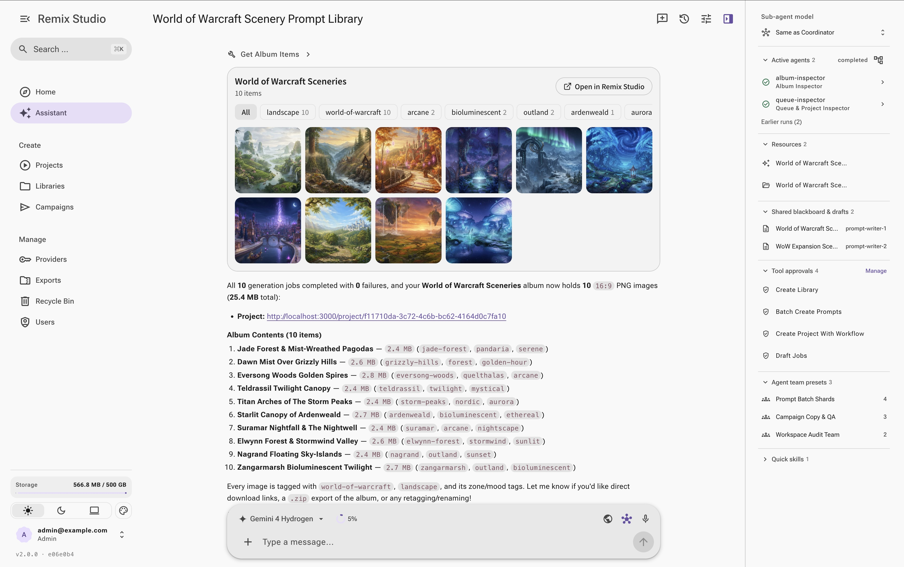
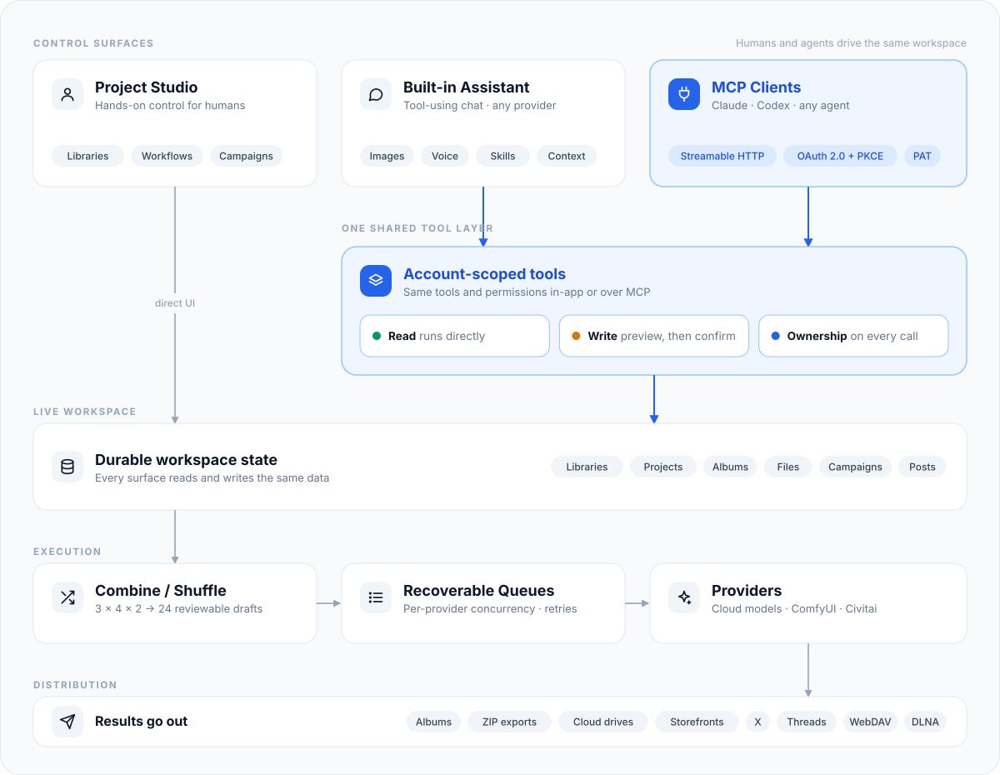

# Remix Studio 2.0 — Multi-Agent Content Operations for Humans and Agents

Remix Studio 2.0 gives creators, teams, and AI agents a shared, self-hosted environment for multimodal generation and social campaigns. Operate the same live workspace through the rebuilt **Material 3 Expressive** studio, the built-in **Multi-Agent Assistant** with inline **MCP Apps**, or external MCP clients such as Claude and Codex.

One account-scoped tool layer—and five interactive MCP App views—powers both AI control surfaces. Coordinators, specialist agent swarms, and connected MCP agents work directly with libraries, projects, workflows, albums, generation batches, models, storage, campaigns, and posts.

<picture>
  <source media="(prefers-color-scheme: dark)" srcset="assets/Screenshot-dark.jpg">
  
</picture>

## One Workspace, Three Control Surfaces

| Control surface | Role |
| --- | --- |
| **Material 3 Studio** | Totally rebuilt Material 3 Expressive interface at `/` with live theme extraction, `Cmd/Ctrl+K` command palette (including `@` settings search), virtualized queues, and hands-on control over libraries, workflows, results, exports, and campaigns |
| **Multi-Agent Assistant** | Persistent multimodal workspace supporting both single-agent turns and `/agents` (`/swarm`) coordinator + specialist worker teams, shared blackboard, interactive architecture graph, step tracker, web search grounding, `ask_user` prompts, generation batch auto-resume, and inline MCP Apps |
| **MCP Server & MCP Apps** | The same core tools and five sandboxed `ui://` MCP Apps views (`media-grid`, `queue-monitor`, `post-preview`, `project-preview`, `generation-batch`) exposed over streamable HTTP with OAuth 2.0 + PKCE or personal access tokens |

The assistant can bind projects, libraries, campaigns, and posts as `@` context, work with images and voice input, run reusable skills, inspect segmented context usage, and track multi-step plans. Both agent paths discover live workspace data instead of reasoning over stale prompts: they curate libraries, inspect albums and files, find usable models, assemble project workflows, launch tracked generation batches, and schedule campaign posts.

<picture>
  <source media="(prefers-color-scheme: dark)" srcset="assets/architecture-dark.svg">
  
</picture>

## From Intent to Distribution

- **Rebuild around Material 3 Expressive** — Dynamic tonal themes from a seed color or image palette, expressive motion springs, `Cmd/Ctrl+K` global search with `@` settings jump, responsive list panes, and image rescaling across model-normalized size tiers.
- **Orchestrate multi-agent teams** — Run single-agent turns or launch `/agents` swarms with built-in presets (*Prompt Batch Shards*, *Campaign Copy & QA*, *Workspace Audit Team*), a flat Agent Side Panel, interactive swarm topology graph, and a live multi-step task tracker.
- **See live results inline with MCP Apps** — Browse media grids, inspect projects, preview campaign posts, monitor queues, and watch tracked generation batches inside sandboxed interactive views directly in chat or in compatible MCP clients.
- **Build reusable knowledge** — Organize prompts, images, video, and audio in typed libraries with titles, tags, search, import/export, browser capture, and mobile sharing, plus dedicated reusable assistant skills.
- **Compose at scale** — Mix fixed inputs with library-backed choices. Run the Cartesian product for exhaustive coverage or use shuffle mode for bounded exploration: 3 subjects × 4 styles × 2 references becomes 24 reviewable drafts.
- **Review before execution** — Remix Studio separates composition from provider calls. Inspect resolved prompts, media contexts, model settings, and workflow snapshots, then queue only the drafts worth running.
- **Run resiliently across providers** — Model profiles drive valid controls for text, image, video, audio, and music workflows. Database-backed jobs, per-provider concurrency, detached polling, restart recovery, tracked generation batches with event-driven assistant auto-resume, and browser push notifications keep pipelines moving.
- **Bring your own pipeline** — Batch an API-format ComfyUI workflow on a GPU you host, or generate images and videos with any checkpoint and LoRA on Civitai; every input combines and shuffles like a regular workflow step.
- **Organise results** — Results inherit the tags of the library items they came from, a vision model can tag albums and libraries for you, and **Copy ID for AI** or **Start chat with AI** hands the assistant or an agent the exact item you mean.
- **Turn output into operations** — Keep results in durable albums, reuse prior configurations, rescale or quick-watermark images, export archives, release packages to Google Drive, OneDrive, or Gumroad, and schedule campaigns for X and Threads.
- **Watch it anywhere** — Browse albums on the living-room TV, in a file manager over WebDAV, or in a TV's own media app over DLNA, read-only and per device.

## Human Control Where It Matters

Agent access stays powerful without becoming opaque. Read tools execute directly; writes pause for a human-readable review. The in-app Multi-Agent Assistant supports per-conversation tool approvals and scoped swarm workers (`read` or `propose`), while external MCP writes use a two-step preview and confirmation hash bound to the exact arguments. Destructive actions remain explicitly gated.

Every tool enforces user ownership. Provider credentials and connected-service tokens are encrypted at rest, stored files are shared through temporary owned URLs, and the multi-user application includes roles, invite-based registration, storage limits, TOTP 2FA, and passkeys.

## Self-Hosted by Design

Run Remix Studio with PostgreSQL, S3-compatible object storage, and Docker. Bring your own model providers, credentials, storage, social applications, and deployment secrets. Install the web app as a PWA and use it in English, Simplified Chinese, Traditional Chinese, Japanese, Korean, or French.

## Documentation

Find detailed setup, configuration, and operations guidance on the [documentation site](https://shinchven.github.io/remix-studio/).

- [Architecture](https://shinchven.github.io/remix-studio/guide/architecture) and [why Remix Studio is different](https://shinchven.github.io/remix-studio/guide/why-different)
- [Multi-Agent Assistant](https://shinchven.github.io/remix-studio/concepts/assistant) and [MCP & MCP Apps](https://shinchven.github.io/remix-studio/integrations/mcp)
- [Workflows and combinations](https://shinchven.github.io/remix-studio/concepts/workflows) and [supported AI workflows](https://shinchven.github.io/remix-studio/concepts/supported-workflows)
- [Providers and models](https://shinchven.github.io/remix-studio/concepts/providers), [campaigns](https://shinchven.github.io/remix-studio/concepts/campaigns), and [exports](https://shinchven.github.io/remix-studio/concepts/exports)
- [Projects and albums](https://shinchven.github.io/remix-studio/concepts/projects), including ComfyUI, Civitai, rescaling, and notifications
- [TV, WebDAV & DLNA](https://shinchven.github.io/remix-studio/integrations/tv-and-devices)
- [Local development](https://shinchven.github.io/remix-studio/guide/local-development) or [Docker deployment](https://shinchven.github.io/remix-studio/guide/docker-deployment)
- [What's new in 2.0.0](https://shinchven.github.io/remix-studio/whats-new)

## Community and License

Report bugs and request features through [GitHub Issues](https://github.com/ShinChven/remix-studio/issues). Released under the [MIT License](LICENSE).
