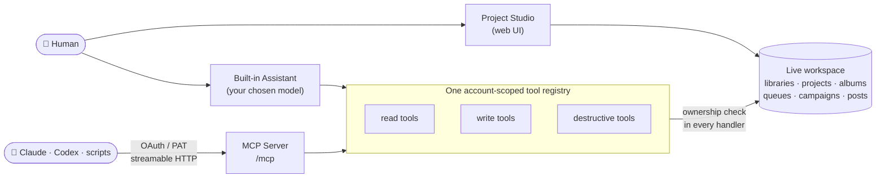
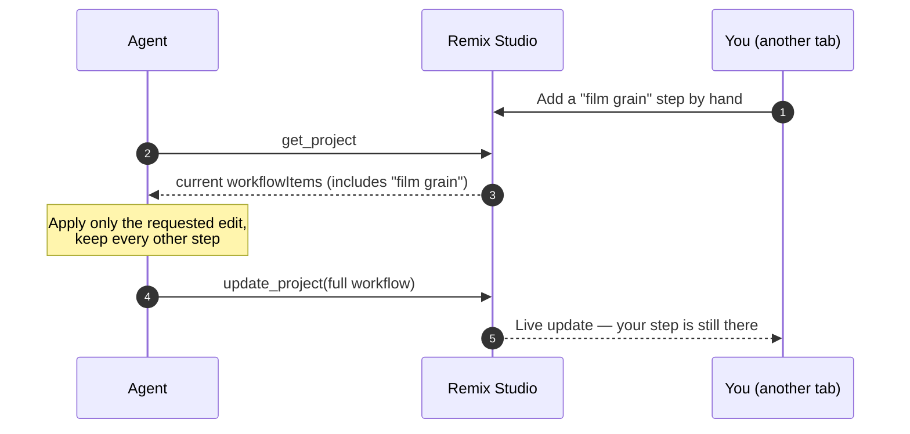
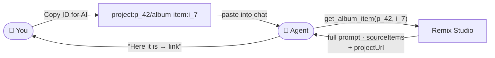
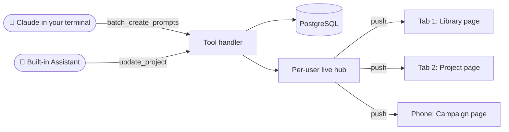
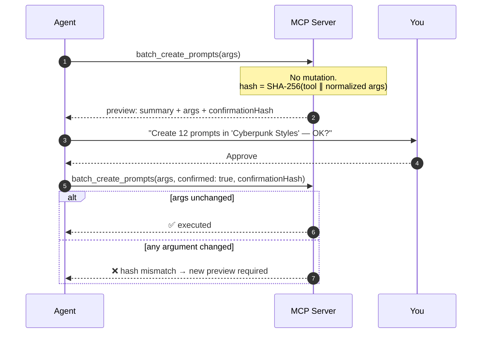
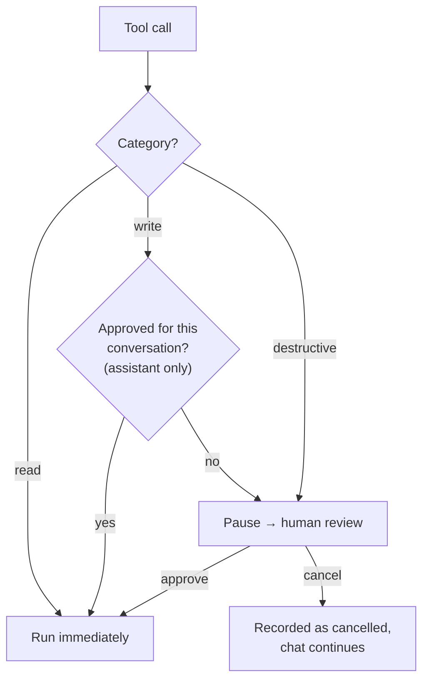
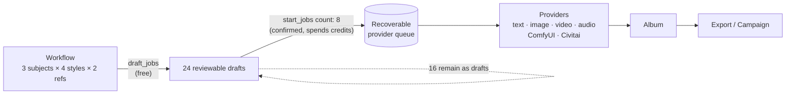
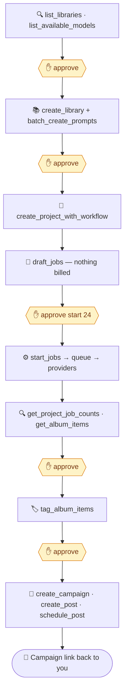

# Why Remix Studio Is Agent-Interactive

*Agents don't just chat about your workspace. They work inside it.*

Many AI creative tools say they "support agents." Usually that means a chat panel that writes a prompt for you to paste into a text box. The agent can describe the work, but you still have to do it.

Remix Studio is built differently. An AI agent, whether that's the built-in assistant or an external client like Claude or Codex, works on the same libraries, projects, albums, queues, and campaigns that you see in the UI. It does this through the same rules, with the same ownership checks, and its changes appear live on your screen. This post covers the design choices behind that.

---

## 1. One tool layer, three ways in

Remix Studio has three control surfaces:

| Surface | Who drives it |
| --- | --- |
| **Project Studio** | You, by hand |
| **Built-in Assistant** | You, in natural language, using the AI provider and model you choose |
| **MCP Server** (`/mcp`) | Any external agent: Claude, Codex, scripts, or anything that speaks MCP or JSON-RPC |



The assistant and the MCP server don't each get their own integration. They share **one account-scoped tool registry** (`server/mcp/tool-definitions.ts`). The in-app assistant runner imports the same definitions that the MCP server exposes. A tool added for one surface is automatically available on the other, with the same input schema, the same validation, and the same handler.

The result is that "what can an agent do?" and "what can the app do?" stay close to the same question. Agents can:

- create and curate **libraries** of prompts, images, video, and audio, then search, tag, and batch-edit them
- inspect **projects**, read their workflows, and build or replace multi-step workflows, including Civitai checkpoint and LoRA projects
- **draft jobs** from a workflow's combination or shuffle engine, then **start** all of them or a chosen number on real providers
- watch the **queue** across every project and provider, and clear failed jobs
- browse **albums**, read a single result's full prompt and source items, and tag or rename results in bulk
- **export** an album or a whole portable project bundle
- set up **campaigns** and posts, attach media, and **schedule** them to X and Threads
- **upload** files (for external clients), using a stage, PUT, and attach flow that keeps file bytes out of tool calls

None of these are mocks or "suggestions." Each one changes real records.

## 2. Agents read the live workspace, not a stale prompt

An agent is only as good as what it knows. Remix Studio doesn't paste a snapshot of your account into a system prompt that goes stale after one turn. Instead, it gives agents **read tools** that return current data: library contents, project workflows, album summaries, job counts, queue depth, storage usage, and which provider/model pairs you can actually use right now (`list_available_models`).

So agents can follow a basic pattern: **look first, then act.** Before changing a workflow, an agent calls `get_project`, starts from what's there now, and keeps every step it wasn't asked to change. The docs and tool descriptions say this explicitly, because `update_project` replaces the whole workflow rather than patching it. A long conversation can't quietly undo an edit you made by hand in another tab.



## 3. Shared references between humans and agents

Pointing an agent at "that image, third row, the one with the blue sky" is error-prone. Remix Studio gives people and agents a shared way to refer to things.

- **Copy ID for AI** copies a typed reference such as `project:<projectId>/album-item:<itemId>`, `library:<libraryId>/item:<itemId>`, or `campaign:<campaignId>/post:<postId>`.
- The MCP server's **instructions** tell connected clients what these shapes mean and which tools take them. A pasted reference therefore leads straight to `get_album_item` or `get_post`, with no searching or guessing.
- **Start chat with AI** opens a new assistant conversation with the reference already in the composer. Inside the assistant, `@` mentions bind libraries, projects, campaigns, and posts as context.
- Going the other way, tools return **absolute record links** (`url`, `projectUrl`, `campaignUrl`, and so on) next to raw IDs. An agent can say "here's the campaign" and give you a link instead of a UUID.

People point at things with IDs, and agents point back with links.



## 4. Changes show up live

If an agent changes your workspace and you have to reload to see it, the agent feels like a black box. Remix Studio pushes changes to every open tab through a per-user live feed (`server/live/`). When the assistant or an external MCP client creates a library, adds prompts, replaces a workflow, or edits a post, the page you have open updates in place.



That makes working with an agent feel interactive. You can watch it build a library while you browse it, or keep a project open while Claude assembles its workflow from your terminal. Long-running generation reports back too: the queue monitor updates, and a browser notification tells you when a project's queue finishes.

## 5. Writes stop for a human, and approval is tied to the exact action

Giving an agent real power only works if a person stays in control. Every tool is classified as **read**, **write**, or **destructive**:

- **Read tools** run immediately.
- **Write tools** pause and show a human-readable summary along with the exact arguments.
- **Destructive tools** always need explicit confirmation and can never be auto-approved.

External MCP clients use a **two-call confirmation protocol** (`server/mcp/tool-confirmation.ts`):

1. The agent calls a write tool without `confirmed: true`.
2. The server makes **no change**. It returns a preview: a plain-language summary (for example, *"Create 12 prompts in library 'Cyberpunk Styles'"*), the normalized arguments, and a `confirmationHash`.
3. The agent shows you that preview.
4. Only after you approve does it call again with `confirmed: true` and the hash.

The hash is a SHA-256 of the tool name plus the normalized arguments. If the agent changes even one argument between the preview and the confirmation, the hash no longer matches and the server rejects the call. Your approval covers that specific action and can't be reused for a different one.





The built-in assistant has an in-app confirmation card instead. For write tools you trust, you can approve the tool for the current conversation only. That never becomes a global permission, and it isn't available for destructive tools. Spending actions are gated too: `start_jobs` uses your provider credits, so it's a confirmed write like any other.

## 6. Built for long, real work

Agent work in Remix Studio often runs long: draft 24 combinations, start them, wait, tag the results, export, schedule a campaign. The system is built for that.

- **Composition is separate from execution.** `draft_jobs` resolves prompts and contexts into reviewable drafts without calling any provider. `start_jobs` then runs only what you choose. An agent can propose a batch of 10,000 drafts, and nothing runs or gets billed until a person approves starting it.


- **Jobs live in the database, not in a browser tab.** Per-provider concurrency, detached polling, retries, and restart recovery mean an agent can start work and check back later with `get_project_job_counts` or `get_queue_status`.
- **Assistant turns run on the server.** If you reload, lock your phone, or lose the connection, the conversation reattaches and replays what you missed. A pending confirmation shows up in any tab.
- **Exports wait politely.** Export tools wait up to a set time and then return a `taskId` to resume, so an agent never has to start a duplicate archive.
- **The assistant keeps a resource trail.** The sidebar lists every library, project, campaign, or post a conversation changed, and which tool made the latest change. You can see exactly what the agent touched.

## 7. Secure by default, not by convention

Being agent-interactive also means assuming the model can be wrong or manipulated, and enforcing safety on the server rather than trusting the prompt:

- **Every handler checks ownership.** An ID the model invents or receives from somewhere doesn't grant access to another user's records.
- **File access goes through `get_file_urls`.** It signs a storage key only if that key is still referenced by media you own, and the URLs are temporary.
- **Uploads are checked against their actual bytes**, not the declared type, and their exact size is verified.
- **MCP authentication** uses OAuth 2.0 with PKCE and rotating refresh tokens, or hashed personal access tokens that can be revoked. `get_current_account` lets an agent confirm which account it's acting on without exposing any secrets.

## 8. Bring your own agent, and your own model

Nothing ties you to one AI vendor:

- The **built-in assistant** runs on a chat provider you configure: Google AI, OpenAI, Anthropic Claude, Alibaba Cloud, Kimi, MiniMax, or APIMart. There's no hidden global key.
- **External agents** connect over streamable HTTP MCP with one config block:

```json
{
  "mcpServers": {
    "remix-studio": {
      "type": "http",
      "url": "https://your-remix-studio.example.com/mcp",
      "headers": { "Authorization": "Bearer YOUR_MCP_TOKEN" }
    }
  }
}
```

- **No MCP SDK?** The endpoint works as plain JSON-RPC over HTTP, so a `curl` loop or a cron script is enough.
- **Skills**, which are reusable prompt templates stored in a text library, let you standardize how the assistant handles recurring tasks. They don't grant any extra permissions.

---

## What this looks like in practice

> **You:** Make a library of 12 cinematic lighting styles, build an image project that crosses them with my "Product Shots" library, draft the combinations, and set up a campaign for the best ones next week.

Here's what the agent does:

1. Calls `list_libraries` to find "Product Shots," and `list_available_models` to pick an image model you can actually use.
2. Previews `create_library` and `batch_create_prompts`. You approve, and the new library appears in your open sidebar.
3. Previews `create_project_with_workflow`. You approve, and the project opens with its two library steps already set up.
4. Calls `draft_jobs`, which returns 12 × N drafts with nothing billed yet, then asks how many to start. You say "the first 24," and it confirms `start_jobs` with `count: 24`.
5. Checks back with `get_project_job_counts`, reads the album with `get_album_items`, and tags the results.
6. Previews `create_campaign`, `create_post`, and `schedule_post`, and gives you a link to the campaign.



You approve each step that changes something. The agent does the routine work in between, and you can watch every result appear on your screen as it happens.

---

**That's what agent-interactive means here:** agents and humans share one workspace, one tool layer, and one set of references, under one set of rules.

Learn more:
- [The built-in assistant](https://shinchven.github.io/remix-studio/concepts/assistant)
- [MCP integration](https://shinchven.github.io/remix-studio/integrations/mcp)
- [Calling MCP tools over HTTP](https://shinchven.github.io/remix-studio/integrations/mcp-http-client)
- [Why Remix Studio is different](https://shinchven.github.io/remix-studio/guide/why-different)
